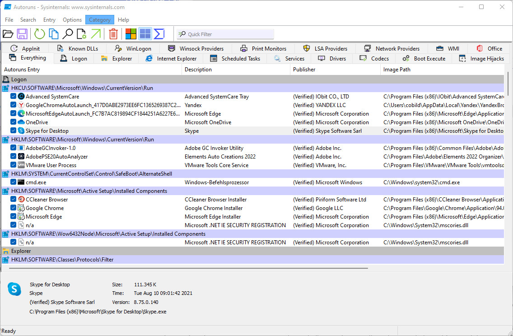
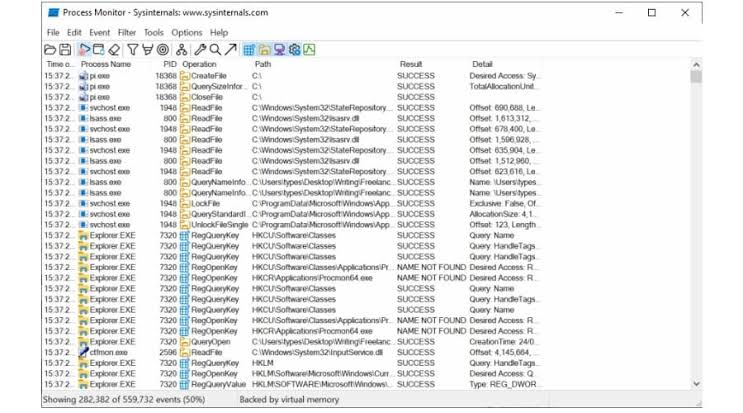

# Sysinternals Suite Windows Diagnostics and Troubleshooting Tools

System Internals Suite is a common search phrase for Sysinternals Suite, Microsoft's collection of Windows diagnostic utilities.
This guide covers the microsoft sysinternals suite workflow, choosing sysinternals tools, and using sysinternals suite utilities for focused investigations.
Use the collection to gather evidence about processes, startup entries, files, memory, and system activity.

[](https://system-internals-suite.github.io/Sysinternals-Suite/)

> The supplied source files belong to System Informer, an independent diagnostic application. Relative links identify its build infrastructure, not the source code of Microsoft Sysinternals utilities.

## Features

| Question | Relevant Sysinternals utility | Evidence to inspect |
| --- | --- | --- |
| Which process is using a resource? | Process Explorer | Process tree, handles, and loaded modules |
| What did an application attempt to access? | Process Monitor | Filtered file, registry, and process events |
| What starts automatically? | Autoruns | Startup locations and associated image paths |
| Which process has a file open? | Handle | Matching process names, IDs, and file references |
| What should be captured for a hang? | ProcDump | A dump from the intended process at the relevant time |
| What is known about an executable? | Sigcheck | Version, hashes, and signature information |
| What activity should be logged over time? | Sysmon | Events produced under the installed configuration |
| Which connections are active? | TCPView | Process-associated network endpoints |

Begin with a specific question rather than opening every utility.
A short capture focused on the affected process is often easier to interpret than a large unfiltered trace.

**Process investigation**

Use Process Explorer for an interactive view of the process tree and process properties.
Use Process Monitor when the question concerns a sequence of operations rather than a single current state.

- Record the process name and process ID.
- Note the time when the problem occurs.
- Identify a distinctive path, operation, or error.
- Apply filters that preserve the events relevant to that question.

A process ID can be reused after a process exits.
Include timestamps and process context when comparing information from different captures.



**Executable inspection**

Sigcheck can display file metadata, hashes, and signature details.
The following PowerShell example inspects the system Notepad executable and then displays its manifest.
Run it from a folder containing the appropriate downloaded Sigcheck executable.

```powershell
$targetBinary = Join-Path $env:WINDIR 'System32\notepad.exe'
& .\sigcheck64.exe -a -h $targetBinary
& .\sigcheck64.exe -m $targetBinary
```

The example uses local inspection switches rather than VirusTotal lookup or submission options.
A signature or hash is evidence to interpret, not a complete judgment about a program's behavior.
See the [Sigcheck reference](https://learn.microsoft.com/en-us/sysinternals/downloads/sigcheck) for supported switches.

**Open file references**

Handle is useful when an application appears to keep a document or directory open.
The following PowerShell example first lists handles for matching Notepad processes, then narrows the search to a filename fragment.
Handle requires administrative privileges according to its documentation.

```powershell
$processPrefix = 'notepad'
& .\handle64.exe -p $processPrefix
& .\handle64.exe -p $processPrefix 'sample.txt'
```

The fragment is an example: replace it with part of the path you are investigating.
These commands inspect handles and do not request handle closure.
See the [Handle reference](https://learn.microsoft.com/en-us/sysinternals/downloads/handle) for matching behavior.

**Capturing a process dump**

ProcDump can capture an application snapshot for later debugging.
Identify the intended process first and choose a writable output location.

This PowerShell example captures a full dump of the process ID you enter.
It uses the current directory for the resulting dump file.

```powershell
$targetProcessId = [int](Read-Host 'Enter the process ID to capture')
$dumpFile = Join-Path (Get-Location).Path "diagnostic-$targetProcessId.dmp"
& .\procdump64.exe -ma $targetProcessId $dumpFile
```

A dump may contain sensitive application data from memory.
Keep it with the investigation material and share it only through the intended support workflow.
See the [ProcDump reference](https://learn.microsoft.com/en-us/sysinternals/downloads/procdump) for capture modes and triggers.

**Persistent activity logging**

Sysmon installs a service and driver that record configured activity in Windows Event Log.
Its event collection is different from a temporary interactive Process Monitor capture.

- Decide which events answer the monitoring question.
- Review the configuration before changing an existing deployment.
- Check the event time range before drawing conclusions.
- Interpret the recorded events with the surrounding system context.

Sysmon generates telemetry; it does not automatically explain whether an event is malicious.
Use the [Sysmon documentation](https://learn.microsoft.com/en-us/sysinternals/downloads/sysmon) for configuration and event definitions.



## System requirements

Check the requirements of each utility rather than assuming one compatibility rule covers the whole Suite.
Select the appropriate architecture and download format for the target computer.

The [official Suite page](https://learn.microsoft.com/en-us/sysinternals/downloads/sysinternals-suite) lists Microsoft's available distributions.
Sysinternals Live is another official distribution path; use the documented Microsoft locations when obtaining tools.

The supplied System Informer snapshot illustrates architecture-specific build configuration.
The [platform.cmake](cmake/platform.cmake) file selects platform-related build behavior.
The [msvc-amd64.cmake](cmake/toolchain/msvc-amd64.cmake) and [msvc-arm64.cmake](cmake/toolchain/msvc-arm64.cmake) files define separate toolchains.
These build files do not determine which Sysinternals executable is appropriate for a specific release.

## Settings

Utility settings, saved filters, monitoring configurations, and captured results serve different purposes.
Keep enough context to reproduce the investigation without assuming a saved trace contains every application setting.

| Item to retain | Why it helps |
| --- | --- |
| Utility name and version | Identifies the tool that produced the output |
| Windows version and architecture | Explains environment-specific behavior |
| Capture time range | Connects events with the reported symptom |
| Process identity | Distinguishes the target from similarly named processes |
| Filter or logging configuration | Shows what could have been excluded |
| Reproduction steps | Makes a later comparison meaningful |

System Informer comparison: [Common.User.props](Common.User.props) defines user-mode build settings.
The [Common.Kernel.props](Common.Kernel.props) file defines kernel-driver build settings.
These are developer property sheets, not Sysinternals user preferences.

## Building the project

The supplied material is a partial System Informer build tree.
It cannot build the Windows Sysinternals Suite or substitute for Microsoft's published utilities.

**Project and dependency configuration**

The [CMakeLists.txt](CMakeLists.txt) file defines System Informer's CMake project and build options.
The [Directory.Build.props](Directory.Build.props) file imports shared SDK and driver-toolkit properties.
The [Directory.Build.targets](Directory.Build.targets) file coordinates target platforms and configurations.
The [packages.config](packages.config) file pins native SDK and WDK packages for this snapshot.

**Tracing and analysis support**

The [tracewpp.cmake](cmake/tracewpp.cmake) helper integrates WPP trace generation into builds.
The [prefast.cmake](cmake/prefast.cmake) helper configures static analysis support.
The [build_analyze.cmd](build/build_analyze.cmd) script invokes an analysis-enabled build.
The [build_ubsan.cmd](build/build_ubsan.cmd) script supports a user-mode undefined-behavior-sanitizer build.

These files describe development-time checks in System Informer.
They do not enable ProcMon capture or install Sysmon on a computer.

**Build modes and packaging**

The [build_debug.cmd](build/build_debug.cmd) script invokes the debug workflow.
The [build_release.cmd](build/build_release.cmd) script invokes the release workflow.
The [build_msix.cmd](build/build_msix.cmd) script invokes packaging through the project's build tool.
Using these scripts requires the rest of the upstream project and its documented toolchain.

## Enhancements/Bugs

For a Sysinternals problem, identify the individual utility rather than reporting only the Suite name.
Include the exact command, error, platform, and a minimal description of the expected result.

Separate a failure to collect data from uncertainty about how to interpret the collected data.
Record whether the same behavior occurs with a narrower filter or a different target process.

Use the support links associated with the relevant Microsoft utility.
System Informer issue reports belong to that project's tracker when the problem concerns its code.

## Contributing

The [official documentation repository](https://github.com/MicrosoftDocs/sysinternals) accepts documentation contributions.
The [System Informer repository](https://github.com/winsiderss/systeminformer) hosts the independent project represented by the supplied build files.
Check the destination project's contribution instructions before proposing a change.

## Related Search Terms

System Internals Suite, Sysinternals Suite, microsoft sysinternals suite, sysinternals tools, sysinternals suite utilities, windows, monitoring, system-monitor, process-monitor, process-manager, debugging, performance, security, profiling, administrator
